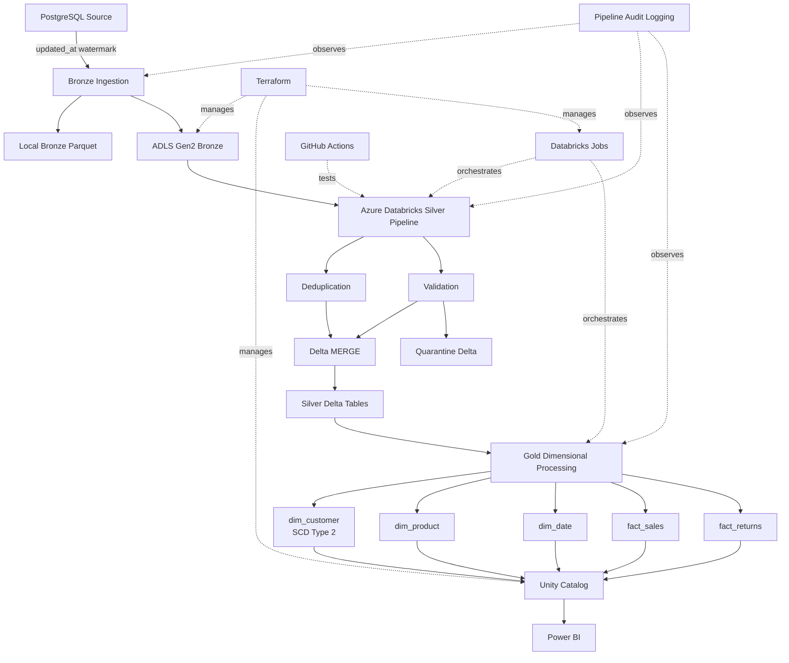

# RetailPulse Architecture

## High-Level Architecture



## Architectural Layers

### Source

The transactional source is PostgreSQL.

Primary source tables:

- customers
- products
- orders
- order_items
- returns

The source includes `created_at` and `updated_at` timestamps to support incremental extraction.

### Bronze

Bronze preserves source data with minimal transformation.

Characteristics:

- immutable Parquet files
- incremental extraction
- partitioned by load date
- technical metadata columns
- local and ADLS copies

Technical metadata includes:

- `_ingested_at`
- `_source_table`
- `_pipeline_run_id`

### Silver

Silver contains cleaned, deduplicated, validated Delta tables.

Main operations:

- incremental read from Bronze
- latest-record deduplication
- type and business-rule validation
- transformation
- quarantine routing
- Delta `MERGE`

Silver tables:

- customers
- products
- orders
- order_items
- returns

### Quarantine

Invalid records are retained rather than dropped.

This makes failures:

- visible
- auditable
- reproducible
- easier to troubleshoot

### Gold

Gold provides an analytics-ready dimensional model.

Dimensions:

- `dim_customer`
- `dim_product`
- `dim_date`

Facts:

- `fact_sales`
- `fact_returns`

### Governance

Unity Catalog governs access to the cloud tables.

Project catalog:

```text
retailpulse
```

Schemas:

```text
bronze
silver
gold
quarantine
```

### Analytics

Power BI consumes the Gold layer.

The intended semantic model is a star schema built around:

- customer
- product
- date
- sales
- returns

## Supporting Platform Capabilities

### Terraform

Terraform manages Azure and Databricks infrastructure.

### Databricks Jobs

The cloud workflow runs:

```text
Silver_Incremental
        ↓
Gold_Dimensional
```

Gold runs only after Silver succeeds.

### GitHub Actions

CI validates code changes automatically.

### Audit Logging

Pipeline runs are recorded centrally for observability.

## Design Principles

RetailPulse follows several production-style engineering principles:

- incremental over full reload where practical
- immutable Bronze storage
- idempotent Delta MERGE processing
- quarantine instead of silent rejection
- data quality before publication
- explicit auditability
- version-controlled infrastructure
- reproducible local development
