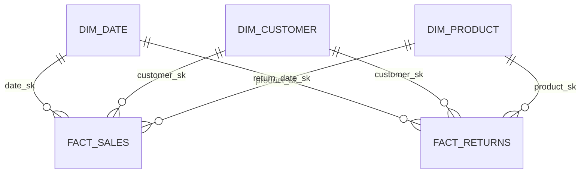

# RetailPulse Data Model

## Overview

The Gold layer uses a star-schema design optimized for analytical reporting.



## dim_customer

`dim_customer` is implemented as Slowly Changing Dimension Type 2.

Purpose:

- preserve customer attribute history
- enable facts to map to the correct historical customer version
- support historical segment and geography analysis

Typical fields include:

```text
customer_sk
customer_id
first_name
last_name
email
address_line_1
city
region
postcode
country
customer_segment
valid_from
valid_to
is_current
attribute_hash
```

### SCD Type 2 Logic

For a changed customer:

1. detect changes using a tracked-attribute hash
2. expire the current row
3. create a new customer version
4. retain both versions

Initial customer versions use an early historical `valid_from` date so historical facts can resolve correctly.

## dim_product

`dim_product` represents product attributes.

Typical fields include:

```text
product_sk
product_id
product_name
category
subcategory
unit_price
unit_cost
```

The current implementation behaves as a Type 1 dimension.

## dim_date

`dim_date` provides standard calendar attributes.

Typical fields include:

```text
date_sk
date
day
month
month_name
quarter
year
week
```

This enables consistent time-based reporting.

## fact_sales

Grain:

```text
one row per order item
```

Typical fields:

```text
date_sk
customer_sk
product_sk
order_id
quantity
net_amount
gross_margin
```

Typical business measures:

- total revenue
- total orders
- units sold
- gross margin
- gross margin percentage
- average order value

## fact_returns

Grain:

```text
one row per return
```

Typical fields:

```text
return_date_sk
customer_sk
product_sk
quantity_returned
refund_amount
return_reason
```

Typical business measures:

- total refunds
- returned units
- return rate

## Historical Customer Join

Sales and returns resolve to customer versions using business-event time.

Conceptually:

```text
fact event date >= dim_customer.valid_from
AND
(
    fact event date < dim_customer.valid_to
    OR dim_customer.valid_to IS NULL
)
```

This prevents historical transactions from being incorrectly attributed to a customer's latest attributes.

## Power BI Relationships

Recommended relationships:

```text
dim_date[date_sk]
    1 ─────── * fact_sales[date_sk]

dim_customer[customer_sk]
    1 ─────── * fact_sales[customer_sk]

dim_product[product_sk]
    1 ─────── * fact_sales[product_sk]

dim_date[date_sk]
    1 ─────── * fact_returns[return_date_sk]

dim_customer[customer_sk]
    1 ─────── * fact_returns[customer_sk]

dim_product[product_sk]
    1 ─────── * fact_returns[product_sk]
```

Use single-direction filtering from dimensions to facts.

## Suggested Power BI Measures

```DAX
Total Revenue =
SUM(fact_sales[net_amount])
```

```DAX
Total Orders =
DISTINCTCOUNT(fact_sales[order_id])
```

```DAX
Units Sold =
SUM(fact_sales[quantity])
```

```DAX
Gross Margin =
SUM(fact_sales[gross_margin])
```

```DAX
Gross Margin % =
DIVIDE(
    [Gross Margin],
    [Total Revenue]
)
```

```DAX
Average Order Value =
DIVIDE(
    [Total Revenue],
    [Total Orders]
)
```

```DAX
Total Refunds =
SUM(fact_returns[refund_amount])
```

```DAX
Returned Units =
SUM(fact_returns[quantity_returned])
```

```DAX
Return Rate % =
DIVIDE(
    [Returned Units],
    [Units Sold]
)
```
